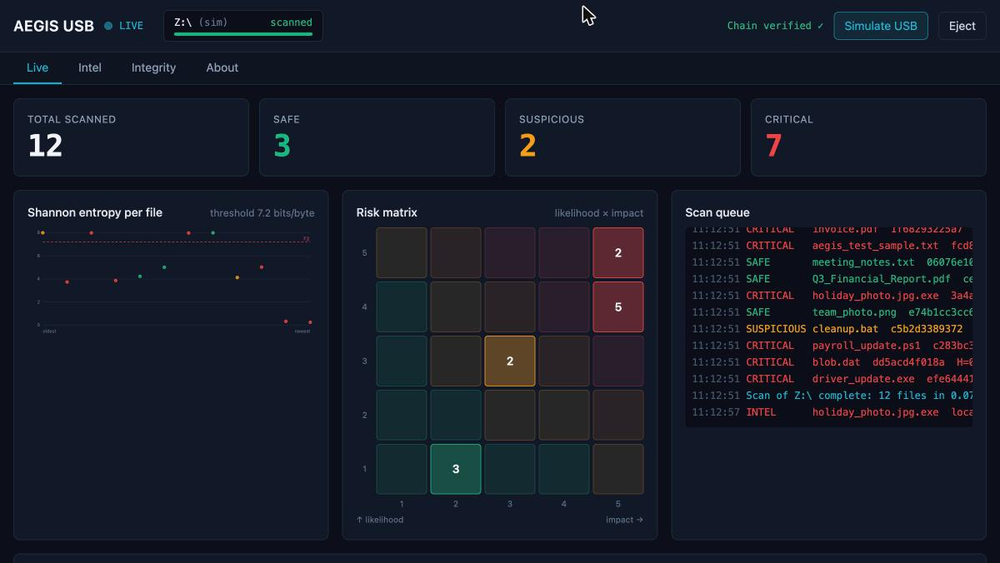

# AEGIS USB

[](https://github.com/Abdul-Rafe8311/inNout-detection/actions/workflows/ci.yml)

**Plug in a drive. See the verdict (hashed, scored, checked against live threat intel, and
cryptographically signed) before anyone opens a file.**

A real-time USB malware screening, threat-intelligence and forensic-integrity system, built as
the IS-353 Information Security course project (NUST SEECS). Every major feature maps to a
lecture week; see the **About** tab in the app or [`docs/COURSE_MAPPING.md`](docs/COURSE_MAPPING.md).



*The Live tab after **Simulate USB**: 12 inert demo files scanned into 3 safe / 2 suspicious /
7 critical, entropy per file, the likelihood × impact risk matrix, and the live scan queue.*

## What it does

- **Detects** a drive within a second and scans it safely (never executes anything): SHA-256,
  entropy, magic bytes, double extensions and right-to-left tricks, hidden single-byte-XOR
  executables, YARA rules, Authenticode presence.
- **Checks threat intel by hash only**: local IOC list, CIRCL (known-good), MalwareBazaar and
  VirusTotal. File contents never leave the machine; an offline mode is built in.
- **Scores risk** as likelihood × impact on a 5×5 matrix, with plain-English reasons and MITRE
  ATT&CK IDs for every verdict.
- **Protects the evidence:** an AES-256-GCM quarantine vault, a hash-chained tamper-evident
  audit log, and scan reports signed with RSA-PSS / Ed25519 / DSA that anyone can verify offline.

## Quickstart

Needs Python **3.11–3.13** (not 3.14 yet), Node.js 20+ and Git. Full steps, the `.env` settings
and troubleshooting are in the [runbook](qa_demo/README.md).

```bash
git clone https://github.com/Abdul-Rafe8311/inNout-detection.git && cd inNout-detection

python3.12 -m venv backend/.venv
backend/.venv/bin/pip install -r backend/requirements.txt
cp backend/.env.example backend/.env                 # then set AEGIS_VAULT_PASSPHRASE
backend/.venv/bin/python qa_demo/generate_payloads.py   # 12 inert demo files
(cd frontend && npm install)

# terminal 1: API on 127.0.0.1:8000 (set AEGIS_PORT / VITE_BACKEND_PORT if 8000 is busy)
cd backend && .venv/bin/python -m app
# terminal 2: dashboard at http://localhost:5173
cd frontend && npm run dev
```

Open the dashboard and click **Simulate USB**. Run `python -m app warm_cache` (from `backend/`)
shortly before a live demo to pre-fill the threat-intel cache. Windows commands are in the
runbook.

```bash
backend/.venv/bin/python -m pytest      # tests (intel is mocked: no real services or keys)
(cd backend && .venv/bin/ruff check .)  # lint
(cd frontend && npm run build)          # strict TypeScript build
```

## Documentation

| Doc | What it covers |
|---|---|
| [`qa_demo/README.md`](qa_demo/README.md) | Setup, "10 minutes before class" runbook, 5-minute demo script, troubleshooting |
| [`docs/COURSE_MAPPING.md`](docs/COURSE_MAPPING.md) | Lecture week → feature → files, with C/I/A tags and honest gaps |
| [`docs/RESEARCH.md`](docs/RESEARCH.md) | USB threat landscape, case studies, commercial kiosks, what we do differently |
| [`docs/THREAT_MODEL.md`](docs/THREAT_MODEL.md) | USB attack surface, trust boundaries, STRIDE for AEGIS itself |
| [`docs/CRYPTO_DESIGN.md`](docs/CRYPTO_DESIGN.md) | Why each algorithm, measured AES-vs-3DES and signature benchmarks, what a CA adds |
| [`docs/RISK_REGISTER.md`](docs/RISK_REGISTER.md) | 14 scored risks with treatments, NIST CSF 2.0 and ISO 27001 mapping |
| [`docs/PRIVACY.md`](docs/PRIVACY.md) | GDPR principles applied, redaction, retention, third-party transfers |
| [`docs/VIVA_QA.md`](docs/VIVA_QA.md) | 25 likely examiner questions with crisp answers |
| [`docs/MASTER_PROMPT.md`](docs/MASTER_PROMPT.md) | The original build specification |

## Team

Replace the placeholders with your names before submitting.

| Member | Name | Module they present | Where to look |
|---|---|---|---|
| **M1** | [Member 1 name] | Backend and OS: USB monitor, safe traversal, AES-256-GCM quarantine vault | `backend/app/core/` |
| **M2** | [Member 2 name] | Detection and threat intel: entropy, magic bytes, XOR, YARA, risk scoring, intel providers | `backend/app/engine/` |
| **M3** | [Member 3 name] | API, integrity and signatures: WebSocket hub, audit hash chain, keystore, signed reports | `backend/app/api/`, `backend/app/crypto/` |
| **M4** | [Member 4 name] | Frontend UI/UX: SOC dashboard, forensic drawer, risk matrix, integrity panels | `frontend/src/` |
| **M5** | [Member 5 name] | QA, payloads, docs and GRC: tests, demo files, risk register, privacy, viva Q&A | `qa_demo/`, `docs/` |

## Honest limits

Static analysis only (no sandbox), so a brand-new threat can pass. **BadUSB-style device attacks
are not detected.** AEGIS reports; it cannot stop the OS mounting a drive. The self-signed
certificates add no trust by themselves, and the local API has no login (it is bound to
localhost and checks request origins). Details: [`docs/THREAT_MODEL.md`](docs/THREAT_MODEL.md)
and [`docs/RISK_REGISTER.md`](docs/RISK_REGISTER.md).

## Safety rules

Scanned files are never executed or opened. Intel lookups are hash-only and never download
samples. Demo payloads are inert bytes (no real malware, no real EICAR file). Secrets live only
in the git-ignored `backend/.env`.
