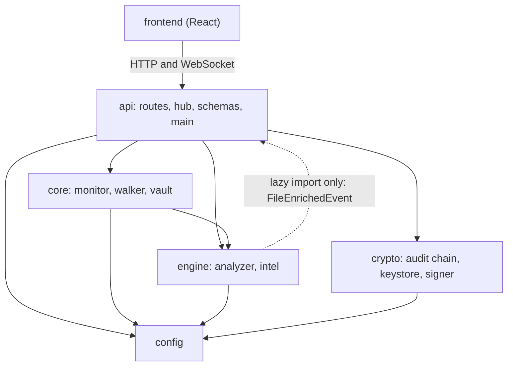
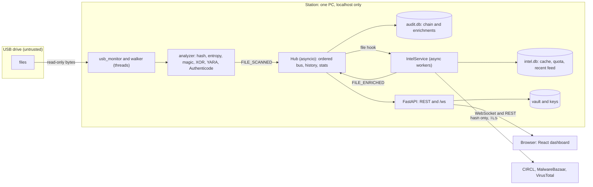
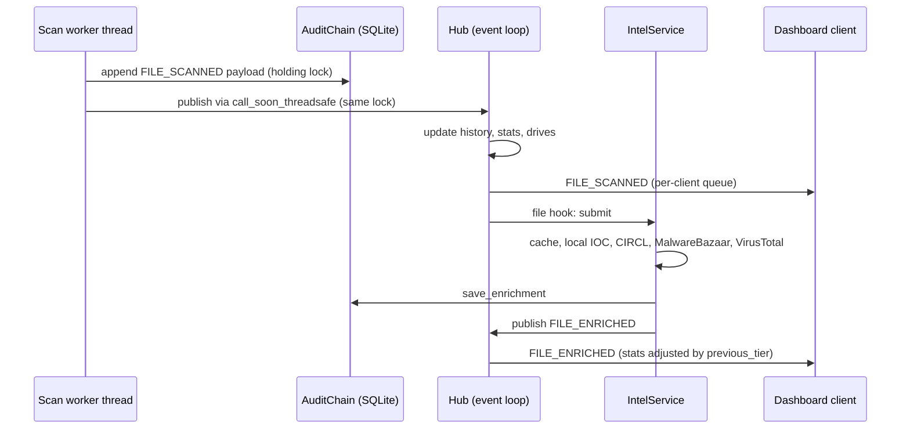
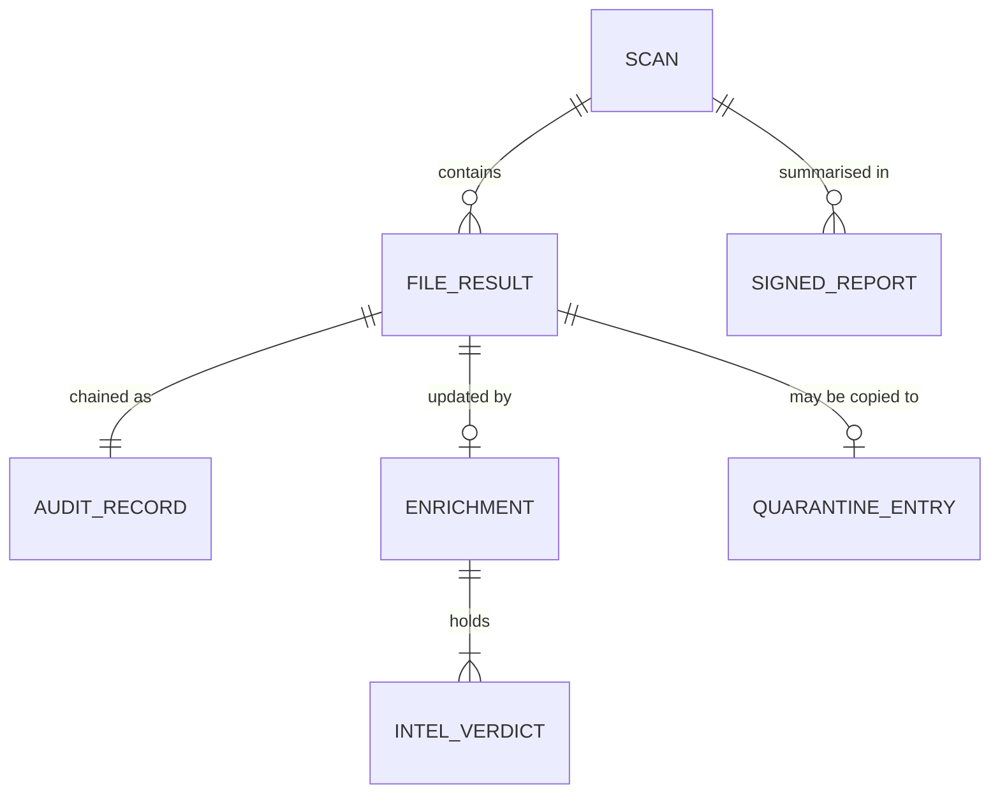
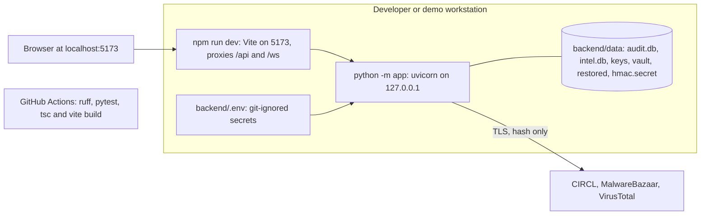

# Architecture Spine: AEGIS USB (as built)

*Reading guide: each **AD** is a decision a future builder could not read off compliant code. **Why / Rejected** lines are kept (contrary to the usual terse spine) because this is also an examiner-facing record; they cite only what the repo or docs show. FR/NFR IDs refer to `docs/prd.md`.*

## Design Paradigm

**Event-driven pipeline with a single ordered bus, inside a layered module structure.**
Producers (scan worker threads, the intel service, REST actions) emit immutable **events**; one
broadcaster on the asyncio loop orders them, updates in-memory state, and fans them out to
WebSocket clients. REST is for actions and queries; everything the dashboard *shows live* is an event.

| Layer | Directory | Owns | May depend on |
|---|---|---|---|
| `core` (M1) | `backend/app/core/` | OS drive monitoring, safe traversal, the Vault | `engine`, `config` |
| `engine` (M2) | `backend/app/engine/` | Pure analysis (hash, entropy, magic, XOR, YARA, Authenticode), tier/risk, intel providers and service | `config` only |
| `crypto` (M3) | `backend/app/crypto/` | Audit chain, keystore, signer | `config` only |
| `api` (M3) | `backend/app/api/` | Schemas (the event contract), Hub, routes, app wiring | all of the above |
| UI (M4) | `frontend/src/` | Presentation of events and actions | HTTP/WebSocket only; never imports backend code |



## Invariants & Rules

### AD-1 — Dependencies point inward; `api` is the only composer [ADOPTED]

- **Binds:** all backend modules.
- **Prevents:** engine or crypto code growing hidden dependencies on the web layer, which would make them untestable alone (the stated reason for modules talking "only through the interfaces", MASTER_PROMPT §6).
- **Rule:** follow the diagram above. `core`, `engine` and `crypto` never import `api`. The single exception is the *function-local* import of `FileEnrichedEvent` in `engine/intel/service.py` (`_enrich`), which exists to avoid an import cycle; do not add others. `core` talks to the outside through the `EventSink` protocol, which `api.ws_manager.Hub` implements.
- **Why / Rejected:** keeps each member's module testable alone; no alternative layout is recorded.

### AD-2 — Blocking work runs in threads; the asyncio loop owns all hub state [ADOPTED]

- **Binds:** FR-1–4, FR-16, FR-24; NFR-2.
- **Prevents:** data races on `history`, `stats`, `drives` and the client set, and a frozen event loop.
- **Rule:** polling, traversal, hashing, YARA and the scan `ThreadPoolExecutor` (default 4 workers) run off-loop. The **only** way a thread hands data to the loop is `Hub.publish` → `loop.call_soon_threadsafe(queue.put_nowait, event)`. `Hub.history`, `Hub.stats`, `Hub.drives` and client queues are mutated **only** on the loop (`_broadcaster`, `add_client`, `remove_client`, and the demo `reset`, which clears history and stats, pushes a fresh SNAPSHOT to every client and drops late intel for the cleared scans; the audit chain is never reset). Route handlers move blocking work with `asyncio.to_thread`. Intel uses async `httpx` and three loop worker tasks.
- **No exceptions:** every SQLite call reaches the loop through `asyncio.to_thread`: `IntelCache` wraps each of its calls, `IntelService._enrich` saves enrichments with `to_thread(audit.save_enrichment, ...)`, and the quarantine route reads the record with `to_thread(audit.get_event, ...)`. Never call an `AuditChain` or `IntelCache` sync method directly from a coroutine. Tests spy on both calls and assert they run off the loop thread.
- **Why / Rejected:** the original spec mandates "no blocking in the event loop" (MASTER_PROMPT §8).

### AD-3 — Events are immutable facts; new knowledge is a new event [ADOPTED]

- **Binds:** FR-20, FR-24, FR-31; `api/schemas.py`, `frontend/src/types/telemetry.ts`.
- **Prevents:** two writers racing to mutate one stored result, and a UI that cannot tell what changed.
- **Rule:** every event is a Pydantic model discriminated on `type`, with `event_id` (uuid4 hex) and UTC `timestamp`. A `FILE_SCANNED` event is never edited after publication. Later intel arrives as `FILE_ENRICHED`, which references `file_event_id` and carries `previous_tier` so the hub can move counters (`SAFE`/`SUSPICIOUS`/`CRITICAL`) by exactly one decrement and one increment. Every model in `schemas.CONTRACT_MODELS` must be mirrored field-for-field in `telemetry.ts`; `test_pydantic_models_match_telemetry_ts_field_for_field` enforces it. `FILE_SCANNED` allows extra fields (forward compatibility), so the loader filters to `model_fields`. A new event type must also be added to the UI reducer, and to `_HISTORY_TYPES` in `api/ws_manager.py` **if it must survive a page refresh** (today: `USB_CONNECTED`, `USB_DISCONNECTED`, `FILE_SCANNED`, `FILE_ENRICHED`, `SCAN_COMPLETE`; progress, heartbeat and audit-status events are live-only).
- **Why / Rejected:** MASTER_PROMPT §7.3 specifies a separate `FILE_ENRICHED` event instead of re-sending rows.

### AD-4 — SNAPSHOT, then stream; slow clients are dropped, not waited for [ADOPTED]

- **Binds:** FR-24, FR-28; NFR-3.
- **Prevents:** gaps or duplicates after a refresh, and one slow browser stalling everyone.
- **Rule:** `Hub.add_client` builds the `SNAPSHOT` (last 500 history events, stats, drives) and registers the client **in one synchronous block with no `await`**. Each client owns a bounded queue (2000) and a writer task; overflow clears the backlog and closes the socket (code 1013). History is a 500-entry ring **in memory only**; stats and drives reset when the server restarts. Clients de-duplicate by `event_id` and replace all state on `SNAPSHOT`.
- **Why / Rejected:** a single shared send loop was rejected in the spec in favour of per-client queues (MASTER_PROMPT §7.3).

### AD-5 — Chain order equals broadcast order [ADOPTED]

- **Binds:** FR-30, FR-24.
- **Prevents:** a chain whose indices disagree with what the dashboard saw.
- **Rule:** `Hub.file_scanned` appends to the audit chain and publishes the event **while holding `AuditChain.lock`** (an `RLock`). `chain_index` and `chain_hash` are set after the append and are **excluded** from the hashed payload. Only `FILE_SCANNED` is chained; enrichments are stored in a separate table and are not part of the chain. If the append fails, the event is still published (without chain fields) and the error is logged; scanning is never stopped by a logging failure. **Scope of the guarantee:** the chain attests the *scan-time* record only; do not describe it as covering enrichments. A signed report therefore copies the chained record verbatim (`tier`, `likelihood`, `impact`, `risk_score`, `mitre`, `reasons`, `chain_index`, `chain_hash`), so those fields always equal the audit-chain record for the same scan (AD-10). Intel-adjusted results (AD-7) are reported alongside, never in place of them: `final_tier`, `final_risk_score`, `final_reasons`, `final_mitre` and the `intel` verdicts.

### AD-6 — Audit chain definition [ADOPTED]

- **Binds:** FR-30–32; `crypto/audit_chain.py`.
- **Prevents:** incompatible re-implementations of "the chain" and silent loss of the tamper-evidence guarantee.
- **Rule:** payload = canonical JSON (sorted keys, `(",", ":")`, non-ASCII kept). `chain_hash = SHA-256(prev_hash ‖ payload)`; genesis `prev_hash` is 64 zeros. Each record also stores `HMAC-SHA-256(secret, chain_hash)`. Indices are 1-based and contiguous; `verify()` returns the first index that fails any of: contiguity, prev link, recomputed hash, HMAC. Stored in SQLite `audit.db`. The secret comes from `AEGIS_HMAC_SECRET`; if absent, a random one is created once in `data/hmac.secret` (mode 0600); an empty secret is rejected. Demo tamper edits a stored payload's `tier` and keeps a backup so it can be undone; it is the only code path allowed to alter a stored payload.
- **Why / Rejected:** a plain checksum was rejected (CRYPTO_DESIGN §4): without the HMAC anyone can recompute a consistent chain.

### AD-7 — Tier and risk are computed in exactly two pure functions [ADOPTED]

- **Binds:** FR-13–15, FR-20; `engine/analyzer.py`.
- **Prevents:** the UI, report builder or intel code deciding tiers differently.
- **Rule:** `analyzer.classify` produces the static Tier, likelihood, impact, reasons and MITRE IDs; `analyzer.apply_intel` is the only place a Tier changes afterward (malicious → CRITICAL 5×5; known-good downgrades only an **entropy-only** SUSPICIOUS, never scripts or RTLO; suspicious intel lifts only SAFE). `risk_score = likelihood × impact`. The UI and the report builder read these values; they never recompute a Tier. The report's `final_tier` is the enrichment's tier when one exists (else the scan-time tier); its `tier` stays the chained one (AD-5).

### AD-8 — One intel pipeline, hash-only, degrading to verdicts [ADOPTED]

- **Binds:** FR-16–23; NFR-4, NFR-7; `engine/intel/*`.
- **Prevents:** a code path that leaks filenames or contents, hangs on the network, or hides a malicious verdict.
- **Rule:** provider order is cache → Local IOC → CIRCL → MalwareBazaar → VirusTotal. Only a SHA-256 (plus the provider's own key header) leaves the machine, over default-verified TLS. `worth_network_lookup` gates network use (non-SAFE, or executable/script by extension or magic). A known-good hit short-circuits the remaining lookups **only** for entropy-only alerts; otherwise the chain continues, because NSRL also lists test files such as EICAR. Network or parsing failures become `error` verdicts (never raised, never cached). HTTP 429 uses Retry-After else 1 s/2 s/4 s back-off. Cache TTL: found 24 h, not-found 1 h. VirusTotal: token bucket 4/min, daily counter (500), reserved for flagged files below 50 remaining. Offline mode is honoured in `IntelService` alone. Live enrichment and `warm_cache` both call `IntelService.lookup_for_event`, so they fill identical cache keys. A source-scanning test forbids disabled certificate checking and sample downloads.
- **Why / Rejected:** uploading files to an intel service was rejected for privacy (VIVA Q3, PRIVACY §2); "known-good always stops" was rejected after the EICAR finding (memlog, Phase 5).

### AD-9 — Scanned files are only ever read as bytes [ADOPTED]

- **Binds:** FR-2, FR-4, FR-6–13; NFR-5.
- **Prevents:** a scanned file being executed, opened by an OS handler, imported or followed through a symlink.
- **Rule:** `analyze_file` opens files read-only and reads each **once** in 64 KB chunks feeding the hasher and byte histogram; headers (first 512 bytes) feed magic and XOR checks; YARA scans by file path (10 s timeout). Files above `AEGIS_MAX_SCAN_FILE_SIZE_MB` (default 50) get header and name checks only: `scan_status="PARTIAL"`, `sha256=None`. The walker never follows symlinks. Parsers (`pefile`, YARA) only ever receive bytes.

### AD-10 — Signing: one canonical form, a verifier that stands alone [ADOPTED]

- **Binds:** FR-33–35; `crypto/signer.py`, `crypto/keystore.py`, `backend/scripts/verify_report.py`.
- **Prevents:** a report that verifies in the app but not offline, or a signature over bytes nobody can reproduce.
- **Report content:** per-file `tier` and scores come from the exact chained record (`AuditChain.events_for_scan`), never from enrichment. `summary` counts `safe`/`suspicious`/`critical` by chained tier and adds `summary.final` with the same counts by `final_tier`, so a CRITICAL intel verdict is visible without breaking the match with the chain. The dashboard's `SignReport` shows both (typed as `ReportBody` in `telemetry.ts`, a UI-only type: the API field stays an opaque `dict`) and lists files whose tier changed after intel.
- **Rule:** signed bytes = `json.dumps(report, sort_keys=True, separators=(",", ":"), ensure_ascii=False).encode()`. Algorithms: `rsa-pss` (RSA-3072, SHA-256, salt length 32, default), `dsa` (3072), `ed25519`. `sign_report` returns a **deep copy** of the report. `verify_report.py` deliberately re-implements the canonical form and imports nothing from `app`, so it needs only `cryptography`; any change to canonicalization must change both (tests run them against each other and against `openssl`). Keys are generated lazily and stored as PEM (mode 0600) under `data/keys/` with a self-signed X.509 certificate (CN "AEGIS Scanner Station", 365 days). Trust is established **out of band** by comparing the SHA-256 of the DER SubjectPublicKeyInfo; a valid signature is never presented as proof of identity.
- **Why / Rejected:** DSA is kept for comparison only because FIPS 186-5 no longer approves it for new signatures; PKCS#1 v1.5 is not offered (CRYPTO_DESIGN §1).

### AD-11 — Vault format and handling rules [ADOPTED]

- **Binds:** FR-37–40; `core/vault.py`, `config.py`.
- **Prevents:** unreadable or forgeable blobs, path traversal, and malware being restored onto a drive.
- **Rule:** `.aegisq` = `"AEGQ1" | salt(16) | nonce(12) | AES-256-GCM ciphertext+tag`. Key = scrypt(N=2¹⁵, r=8, p=1) over `AEGIS_VAULT_PASSPHRASE` and a fresh per-blob salt; nonce is fresh random; the file's SHA-256 is bound as associated data. Metadata lives in `<id>.json`; ids are 32 lowercase hex characters and validated before any path use. Quarantine **copies**; the original is left alone. Restore writes only to `data/restored/`, re-hashes and fails cleanly on a wrong passphrase or altered blob. Deleting an original is a separate, explicit action that re-hashes first and is refused for the simulated drive. A missing passphrase yields HTTP 503; one is never generated. `AEGIS_VAULT_CIPHER` accepts only `aes-256-gcm`; DES, 3DES, RC4, Blowfish and aliases abort start-up.

### AD-12 — Local API posture: no login, so narrow the doors [ADOPTED]

- **Binds:** FR-5, FR-29, FR-42, FR-51 (not built); `api/main.py`, `api/routes.py`.
- **Prevents:** a web page in the operator's browser driving the local API.
- **Rule:** start the server with `python -m app`, which binds `127.0.0.1`. CORS allows only `http://localhost:5173` and `http://127.0.0.1:5173` (plus `AEGIS_EXTRA_ORIGINS`). Middleware returns 403 for any non-GET/HEAD/OPTIONS request that carries a non-allowed `Origin`, and the WebSocket handler closes (1008) on a non-allowed `Origin`; requests with no `Origin` (curl, tests) pass. `/api/demo/*` is gated by `AEGIS_DEMO_MODE`. `GET /api/files/*` serves only paths on the Course Map allowlist (plus the named docs), never `.env`. The Vite dev server uses `strictPort` so the dashboard origin cannot drift.
- **Why / Rejected:** CORS alone was rejected because it does not stop a cross-site *write* (found while writing the threat model). A per-run token is not built (Deferred).

### AD-13 — All configuration flows through `get_settings()` [ADOPTED]

- **Binds:** all modules; NFR-6.
- **Prevents:** scattered `os.getenv` calls, secrets in code, and tests that touch real services.
- **Rule:** read configuration only via `config.get_settings()` (`lru_cache`d dataclass from `AEGIS_*` variables and `backend/.env`). Invalid values (e.g. a legacy cipher) raise `ConfigError` at start-up. Secrets live only in the git-ignored `.env`. `qa_demo/conftest.py` sets every secret/intel variable explicitly (even to empty, which stops python-dotenv overriding it), forces offline mode, and gives each test its own data directory.

### AD-14 — Persistence layout; hub state is not persisted [ADOPTED]

- **Binds:** FR-30–32, FR-33, FR-37, FR-47; NFR-3.
- **Prevents:** two owners of one piece of data, and surprise about what survives a restart.
- **Rule:** the data directory (`AEGIS_DATA_DIR`, default `./data`) holds `audit.db` (audit records + enrichments), `intel.db` (cache, quota, recent feed), `keys/`, `vault/`, `restored/`, `hmac.secret`; all git-ignored. SQLite connections use `check_same_thread=False` guarded by an explicit lock. **Owners:** `AuditChain` owns `audit.db`; `IntelCache` owns `intel.db`; `KeyStore` owns `keys/`; `Vault` owns `vault/`. Nothing else writes them. Hub history, stats and drives are memory only. Retention (`AEGIS_RETENTION_DAYS`) purges only the intel cache at start-up.

### AD-15 — Dashboard state: one reducer, one socket, batched [ADOPTED]

- **Binds:** FR-24–29; NFR-2.
- **Prevents:** state split across components and render storms on fast scans.
- **Rule:** `useAegisSocket` owns the WebSocket and a single reducer. Incoming events are buffered and dispatched once per animation frame, de-duplicated by `event_id`, with reconnect back-off 0.5 s doubling to 10 s with jitter. Rows are `FileScannedEvent` merged with enrichment (`Row`); counters come from the server snapshot then change by event. Components receive props only; actions go through `api.ts`. Auto-dismiss timers depend on **stable** callbacks (`useCallback`). Charts are hand-written SVG (no chart library); fonts are the system stack, so the UI works offline. Calls use relative `/api` and `/ws` through the Vite proxy (`VITE_BACKEND_PORT`).
- **Why / Rejected:** a heavy chart library was rejected in the spec (MASTER_PROMPT §5).

### AD-16 — The Course Map is generated, and its links are tested [ADOPTED]

- **Binds:** FR-29, FR-44, FR-45; `course_map.py`.
- **Prevents:** documentation and UI drifting from the code.
- **Rule:** `backend/app/course_map.py` is the single source for the About tab (`/api/course-map`), the file allowlist and `docs/COURSE_MAPPING.md` (regenerated by `backend/scripts/gen_course_mapping.py`). Tests fail if a listed file is missing or the doc is stale. Docs must keep a References section with URLs and an access date.

### AD-17 — Quality gates [ADOPTED]

- **Binds:** NFR-1, NFR-9; `.github/workflows/ci.yml`, `pytest.ini`, `qa_demo/`.
- **Prevents:** regressions merging unseen and flaky network-dependent tests.
- **Rule:** CI runs `ruff check`, `pytest` (per-test timeout 60 s) and `npm ci && npm run build` (strict TypeScript) on every push and pull request (Ubuntu, Python 3.12, Node 22). Network behaviour is tested with `respx` mocks; tests never use real services or keys. Python 3.11–3.13 only (`yara-python` has no 3.14 wheel).

### AD-18 — Removable-drive detection is a pure, per-OS rule [ADOPTED]

- **Binds:** FR-1; `core/usb_monitor.py`.
- **Prevents:** treating system volumes or disk images as USB.
- **Rule:** `is_removable(partition, system)` is a pure function. Windows: `removable` option and not `cdrom`. Linux: `/media`, `/run/media`, or sysfs `removable == 1`, and **never** `/mnt` (WSL mounts `C:` there). macOS: `/Volumes/*` excluding the system volume and reserved names, then `diskutil info -plist`: `BusProtocol == "Disk Image"` is rejected first (disk images also report `RemovableMedia`), USB or removable media accepted; the verdict is cached per mount point and a failed lookup is **not** cached.

## Consistency Conventions

| Concern | Convention |
| --- | --- |
| Naming | Events `UPPER_SNAKE` (`FILE_SCANNED`); Python `snake_case` files and functions; React components `PascalCase.tsx`; configuration `AEGIS_*`; frontend-only `VITE_*`. |
| Identifiers | `event_id`, `scan_id`, quarantine ids: uuid4 hex (32 lowercase characters). Hashes: lowercase hex SHA-256 (64). |
| Time | UTC ISO-8601 with `Z`, seconds precision. |
| Enumerations | Tier `SAFE`/`SUSPICIOUS`/`CRITICAL`; `scan_status` `COMPLETE`/`PARTIAL`; intel status `malicious`, `suspicious`, `clean`, `known_good`, `not_found`, `error`, `skipped`; signature algorithm `rsa-pss`/`dsa`/`ed25519`. |
| Errors | REST errors are FastAPI `{"detail": "<message>"}` with 4xx/5xx; vault and config errors are typed (`VaultError`, `ConfigError`) and mapped at the edge; scanning workers log and skip a bad file, never abort the scan. |
| Logging | Structured `key=value` to stdout (`ts=… level=… logger=… msg=…`); never log keys, headers or file contents. |
| State mutation | Per AD-2 and AD-14: hub state on the loop only; each datastore has one owner. |
| Auth | None (AD-12). |
| Canonical JSON | One form for hashing and signing (AD-6, AD-10). |

## Stack

*Versions are those installed and tested on 2026-11-20. `requirements.txt` lists floors (`>=`); there is no Python lockfile (Known Limits L-6). The frontend is locked by `package-lock.json`.*

| Name | Version |
| --- | --- |
| Python (supported 3.11–3.13) | 3.12.15 |
| FastAPI / Starlette | 0.165.0 / 1.10.0 |
| Uvicorn / websockets | 0.54.0 / 17.4 |
| Pydantic | 2.14.4 |
| psutil | 7.2.2 |
| yara-python | 4.5.4 |
| cryptography | 50.0.2 |
| httpx | 0.28.1 |
| pefile | 2024.8.26 |
| python-dotenv | 1.2.4 |
| SQLite | Python standard library `sqlite3` |
| pytest / pytest-asyncio / pytest-timeout / respx | 9.2.0 / 1.5.0 / 2.4.0 / 0.23.1 |
| ruff | 0.17.6 |
| Node.js (local / CI) | 24.19.0 / 22 |
| React / React DOM | 19.3.1 |
| TypeScript | 7.0.2 |
| Vite / @vitejs/plugin-react | 8.3.8 / 6.3.0 |
| Tailwind CSS / @tailwindcss/vite | 4.3.5 |
| GitHub Actions | checkout v4, setup-python v5, setup-node v4 |

## Structural Seed

### Runtime view



### One file's life (ordering guarantees from AD-2, AD-4, AD-5)



### Core entities



### Deployment, environments and operations



- **Environments:** developer/demo workstation and CI only. There is **no production target**; the backend does not serve `frontend/dist/`, so the dashboard runs on the Vite dev server.
- **Operations:** logs to stdout; no metrics, tracing, alerting or backup. `backend/data/` is the only state worth keeping; deleting it resets keys, the audit chain, the vault and the cache.
- **Demo runbook** (`qa_demo/README.md`): `python -m app warm_cache` ten minutes before; `AEGIS_INTEL_OFFLINE=true` as the network fallback.

### Source tree (scaffold; the code owns the detail)

```text
backend/app/
  __main__.py            # `python -m app` (serve | warm_cache)
  config.py  course_map.py  warm_cache.py
  core/    usb_monitor.py  walker.py  vault.py
  engine/  analyzer.py hasher.py entropy.py magic_bytes.py xor_detect.py authenticode.py yara_scanner.py
           intel/  base.py cache.py local_ioc.py hashlookup.py malwarebazaar.py virustotal.py service.py
  crypto/  audit_chain.py  keystore.py  signer.py
  api/     main.py  routes.py  schemas.py  ws_manager.py
  rules/   usb_threats.yar
backend/scripts/         # verify_report, bench_ciphers, avalanche_demo, gen_course_mapping
frontend/src/            # App.tsx, api.ts, hooks/useAegisSocket.ts, types/telemetry.ts, components/*, lib/*
qa_demo/                 # generate_payloads.py, conftest.py, test_*.py (139 cases), README.md
docs/                    # prd.md, architecture.md, stories/, design docs
.github/workflows/ci.yml
```

## Capability → Architecture Map

| Capability / Area (PRD) | Lives in | Governed by |
| --- | --- | --- |
| Drive monitoring, traversal, cancel, size cap (FR-1–5) | `core/usb_monitor.py`, `core/walker.py` | AD-1, AD-2, AD-9, AD-18 |
| Static detection (FR-6–13) | `engine/*` (non-intel) | AD-1, AD-9 |
| Tiers and risk (FR-14–15) | `engine/analyzer.py` | AD-7 |
| Threat intel (FR-16–23) | `engine/intel/*`, `warm_cache.py` | AD-2, AD-8, AD-13 |
| Realtime hub and dashboard (FR-24–29) | `api/ws_manager.py`, `api/schemas.py`, `frontend/src/*` | AD-2, AD-3, AD-4, AD-15, AD-16 |
| Audit chain (FR-30–32) | `crypto/audit_chain.py`, `api/ws_manager.py` | AD-5, AD-6, AD-14 |
| Keys and signed reports (FR-33–36) | `crypto/keystore.py`, `crypto/signer.py`, `scripts/verify_report.py`, `api/routes.py` | AD-10, AD-14 |
| Quarantine Vault (FR-37–41) | `core/vault.py`, `config.py` | AD-11, AD-13 |
| Protecting the Station (FR-42–43) | `api/main.py`, `api/routes.py`, `qa_demo/conftest.py` | AD-12, AD-13, AD-17 |
| Documentation and GRC (FR-44–47) | `docs/*`, `course_map.py` | AD-16 |
| Not built (FR-48–53) | n/a | Known Limits, Deferred |

## Known Limits (as built)

| ID | Limit | Consequence | Recorded |
| --- | --- | --- | --- |
| L-1 | **No API authentication**; protection is localhost binding, CORS and the Origin check (AD-12). | Any local process can call the API. | RISK_REGISTER R3 |
| L-2 | **Single process, single host**; the hub is one in-memory object. | No horizontal scale or failover; history, stats and drives reset on restart (AD-4, AD-14). | PRD §10 |
| L-3 | **SQLite files** guarded by explicit locks, one writer per file. | Chain appends are synchronous per file (throughput bound); no concurrent processes on one data dir. | AD-14 |
| L-4 | *Resolved:* the two on-loop SQLite calls (`save_enrichment`, `get_event`) now use `asyncio.to_thread`. | None; kept for ID stability. | AD-2 |
| L-5 | **Verification was macOS-only.** Windows and Linux logic is unit-tested with fakes; a real USB stick was never exercised on any OS; no 2–5 GB run. | Platform claims are unproven on the demo OS. | PRD FR-1, FR-53 |
| L-6 | `requirements.txt` uses `>=` floors with **no Python lockfile**; Python 3.14 unsupported. | Rebuilds may pick newer dependency versions. | AD-17 |
| L-7 | **Chain tail truncation is undetectable** by the chain alone; self-signed certificates add no trust. | Evidence is tamper-evident, not tamper-proof; trust needs an out-of-band fingerprint. | CRYPTO_DESIGN §4–5, R12 |
| L-8 | Station private keys are **unencrypted PEM** (mode 0600). | Theft of `data/keys/` compromises signing. | RISK_REGISTER R6 |
| L-9 | Dashboard is served by the **Vite dev server**; `dist/` is not served by the backend. | No packaged production deployment. | Operations above |
| L-10 | Static analysis only; **no HID/firmware or sandbox** checks. | BadUSB and zero-days are out of reach. | THREAT_MODEL, R1, R2 |
| L-11 | UI behaviour has **no automated browser tests**. | Verified by the strict build and manual click-throughs. | PRD FR-26–28 |

## Deferred

- **API authentication / per-run token** — localhost binding plus the Origin check suffice for a single-operator demo; revisit before any shared or remote use.
- **Multi-process or scale-out topology** — one workstation is the only target; the hub's in-memory state would need an external bus first.
- **Key protection (HSM/KMS, encrypted PEM)** and **external anchoring of the chain head** — production concerns outside the course scope.
- **Packaged deployment (serving `dist/`, installer, service)** — no production environment exists.
- **Metrics, tracing, backup and retention for the audit log and Vault** — retention conflicts with tamper-evidence and needs a policy decision (PRIVACY §4).
- **Large-drive performance budget and real-hardware validation** — unmeasured; do before claiming any throughput.
- **Device-level (HID/firmware) detection** — a different subsystem; the threat model records the gap.
